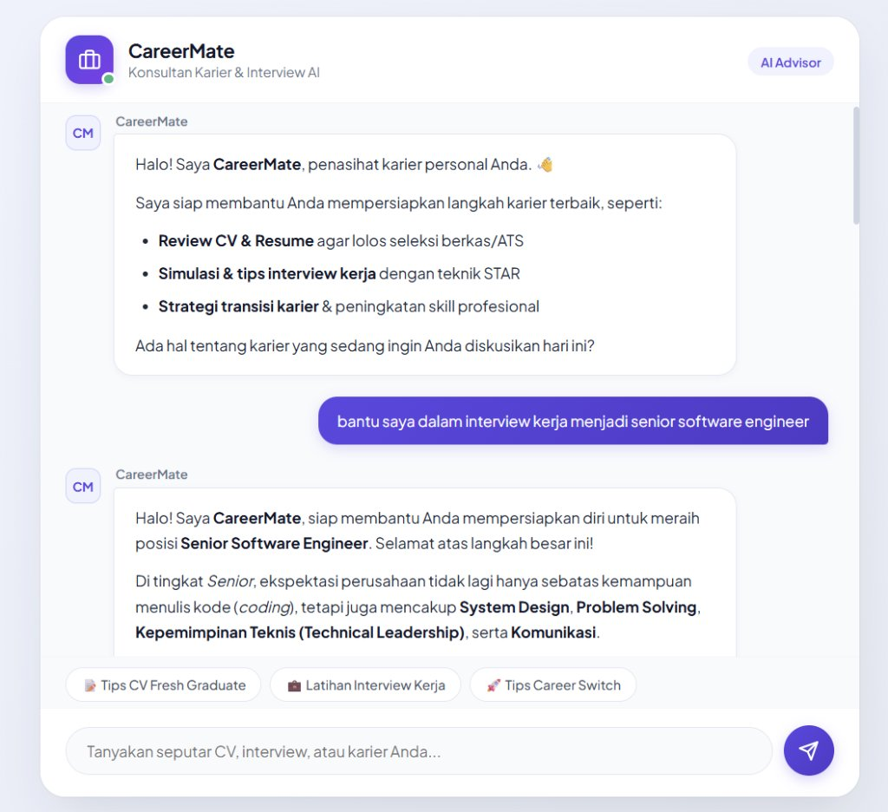

# CareerMate — AI Career Advisor

Aplikasi chatbot web berbasis Node.js & Express yang terintegrasi dengan Google Gemini API. Dibuat khusus sebagai asisten interaktif untuk membantu persiapan karier, mulai dari simulasi wawancara kerja, tips review CV/resume, hingga diskusi seputar pengembangan skill dan transisi karier.



---

## Fitur Utama

- **Fokus Khusus Topik Karier**: Memanfaatkan *system instruction* pada Gemini API agar bot konsisten berperan sebagai konsultan karier profesional, terstruktur, dan tidak melenceng ke topik di luar karier.
- **Dukungan Multi-turn Chat**: Riwayat percakapan dikirim ke backend sehingga bot mengingat konteks tanya-jawab sebelumnya.
- **Tampilan Bersih & Responsif**: UI modern dengan tema clean, indikator loading/mengetik, serta quick prompt chips untuk pertanyaan umum.
- **Markdown & Code Rendering**: Output teks dari bot diparsing rapi menggunakan `marked` dan disanitasi dengan `DOMPurify` agar aman dari XSS.

---

## Tech Stack

- **Backend**: Node.js (ES Modules), Express.js
- **SDK**: `@google/genai` (Google Gen AI SDK resmi)
- **Frontend**: HTML5, CSS3, Vanilla JavaScript
- **Pustaka Tambahan**: `marked` (Markdown renderer), `DOMPurify` (HTML sanitization)

---

## Cara Menjalankan di Lokal

### 1. Prasyarat
- Pastikan sudah menginstal [Node.js](https://nodejs.org/) (versi 18 ke atas direkomendasikan).
- Akun Google AI Studio untuk mendapatkan API Key ([Google AI Studio](https://aistudio.google.com/)).

### 2. Clone Repositori
```bash
git clone https://github.com/USERNAME-ANDA/gemini-chatbot-api.git
cd gemini-chatbot-api
```

### 3. Install Dependensi
```bash
npm install
```

### 4. Konfigurasi Environment Variables
Buat file `.env` di root folder proyek (atau salin dari `.env.example`):

```bash
cp .env.example .env
```

Buka `.env` lalu masukkan API Key Gemini Anda:
```env
GEMINI_API_KEY=masukkan_api_key_gemini_di_sini
PORT=3000
```

### 5. Jalankan Aplikasi
```bash
npm start
```

Buka browser dan akses:
```
http://localhost:3000
```

---

## Struktur Folder

```text
gemini-chatbot-api/
├── public/              # File frontend static
│   ├── index.html       # Struktur halaman & UI chat
│   ├── style.css        # Styling tema & layout
│   └── script.js       # Logika chat, state percakapan, & fetch API
├── screenshots/         # Dokumentasi tangkapan layar
│   └── preview.jpg
├── .env.example         # Template konfigurasi env
├── .gitignore           # File/folder yang diabaikan Git
├── index.js             # Server Express & integrasi Gemini API
├── package.json
└── README.md
```

